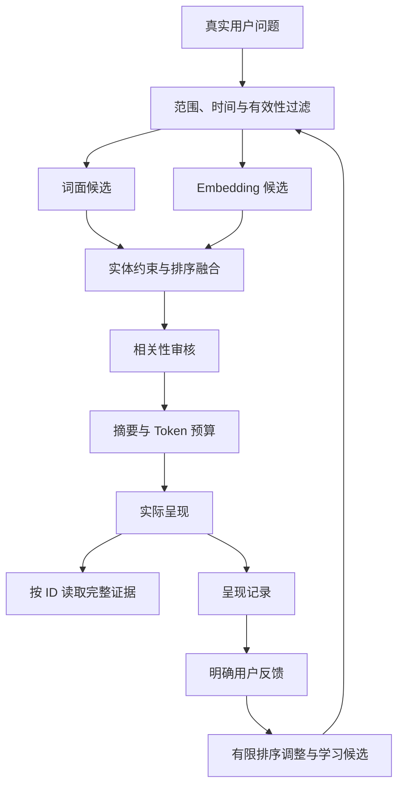

# 混合检索、学习反馈与分阶段启用设计

> 用户于 2026-11-17 明确要求保持不外接嵌入模型，本草案停止实施。
> 当前约束与实施方案见 [本地检索与学习闭环](memory-local-learning.md)，下文仅保留为历史设计记录。

## 目录

- [范围与现状](#范围与现状)
- [建议的模块边界](#建议的模块边界)
- [第 5 阶段：混合检索](#第-5-阶段混合检索)
- [索引与持久化](#索引与持久化)
- [第 6 阶段：自主学习与反馈](#第-6-阶段自主学习与反馈)
- [第 7 阶段：宿主验收与启用](#第-7-阶段宿主验收与启用)
- [配置、成本与诊断](#配置成本与诊断)
- [验收目标与待验证项](#验收目标与待验证项)
- [依据与后续入口](#依据与后续入口)

## 范围与现状

用户已授权在独立 worktree 规划第 5–7 阶段，本文件是待实现方案。
基线为 `81ec60d`，第 1–2 阶段已实现消耗计量、离线评测和原句摘要。
第 3–4 阶段的 TypeScript 迁移与 SQLite 增量检索索引尚未实施。

本方案建议先保留 JavaScript 与现有存储契约，通过适配器增加语义候选和反馈记录。
TypeScript 可在接口稳定后逐步迁移；SQLite 是索引存储选项，单独引入它不能替代分词和相关性判断。
现有工具参数、项目范围、生命周期、事实纠正与摘要读取流程继续作为实现约束。

| 已核对事实 | 依据 | 对本方案的影响 |
| --- | --- | --- |
| 每次召回按候选正文重建词面索引 | `index.js` 的 `runRecallCore` | 先隔离检索接口，后续接入增量实现 |
| 自动路径使用原用户问题并独立审核候选 | `index.js` 的 `agent/pre-step` | 语义检索只提供候选，不能直接决定注入 |
| 精确实体冲突可令词面分归零 | `memory-retrieval.js` | 该约束必须覆盖向量和联想通道 |
| 学习只比较最多 20 条已有摘要 | `memory-intelligence.js` 的 `selectExisting` | 语义重复与冲突检索存在扩充空间 |
| 访问次数在呈现时增加 | `index.js` 的 `reinforceHits` | 呈现不能作为“事实正确”或“用户认可”的标签 |
| `metrics` 只保存本次加载计数 | `memory-metrics.js` | 有学习价值的明确反馈需要独立持久化 |
| DSH 源码中的 SQLite 后端公开 KV 接口 | 宿主 `storage-sqlite/src/index.ts` | 不读取其私有连接，也不直接改宿主数据库 |
| 本机 Electron 44.7.0、Node 24.21.0、SQLite 3.53.4 支持 FTS5 | 本轮内存数据库探测 | 只证明本机能力，目标版本仍需兼容验收 |

第 1–2 阶段的 22 条标注问题包含 2 条用户案例，每条执行自动与显式两条路径。
关闭 LLM 审核与同义扩展时，自动路径 Precision@5 为 70%、Recall@5 为 93.3%，有 6 条误召回和 1 条漏召回。
显式路径 Precision@5 为 38.1%、Recall@5 为 100%，有 26 条误召回。
这说明后续需同时减少无关候选并补齐同义表达，不能只提高“找得到”的比例。

这些数值只描述小规模离线词面基线，不代表启用模型审核后的实际表现。
本轮没有连接 Embedding 服务、回填向量、修改个人 profile 或调整运行时默认值。

## 建议的模块边界



| 模块 | 职责 | 拟实现位置 |
| --- | --- | --- |
| `EmbeddingProvider` | 文本批量转向量、报告实际模型标识与消耗 | `memory-embedding.js` |
| `SearchIndex` | 按范围搜索、按版本更新、提供覆盖率 | `memory-search-index.js` |
| `RecallPlanner` | 合并候选、应用硬约束、解释各通道排名 | `memory-hybrid.js` |
| `FeedbackStore` | 持久呈现记录与明确反馈，提供幂等写入 | `memory-feedback.js` |
| `LearningPolicy` | 学习触发、来源检查、重复与冲突处理 | 扩展 `memory-intelligence.js` |
| 宿主接线 | 范围解析、写队列、模型取消、配置和 Remote | 沿用 `index.js` 与 `client.js` |

接口先以 JSDoc 和现有 JSON Schema 表达，内部计算保持同步。
模型请求和持久化接口使用 Promise，校验放在配置、模型响应、工具请求与存储加载边界。
沿用工具错误 `{code, message}` 和 GUI Remote 错误协议，公共响应只做兼容扩展。

核心接口草案：

| 接口 | 输入 | 输出及语义 |
| --- | --- | --- |
| `embedBatch(request, signal)` | `purpose: query/document`、文本数组、模型配置 | 有序向量、实际模型版本、维度、归一化约定、可选 usage |
| `search(request)` | 已解析范围、过滤条件、query、候选预算、signal | 记忆 ID、版本、通道排名、匹配片段与耗时 |
| `upsertDocuments(documents)` | 已提交记忆的语义版本和文本片段 | 提交对应版本的派生索引 |
| `getIndexStatus()` | 无 | 当前 generation、覆盖率、积压、失败和最近核对时间 |
| `recordExposure(exposure)` | 实际呈现的 ID、版本和本次决策指纹 | 服务端生成的 `exposureId` |
| `recordFeedback(feedback)` | `eventId/exposureId/memoryId/memoryVersion/kind` | 已接收事件或相同事件的既有结果 |

`search` 的候选不是最终命中；调用者仍重新读取当前事实和生命周期。
诊断模式增加 `traceId/channels/gates`，普通摘要响应不重复携带全部排名与长解释。

## 第 5 阶段：混合检索

### 请求流程

1. 按现有规则解析 `projectId/includeGlobal`、时间窗、层级和自动或显式路径。
2. 为满足范围与生命周期的当前记录构造可检索集合。
3. 词面通道提取最多 20 条候选，完整技术实体继续使用现有分词。
4. 已配置且可用时调用 query Embedding，向量通道在同一过滤集合中取最多 20 条。
5. 两通道按记忆 ID 合并，同一记忆的多个片段只占一个名额。
6. 应用原问题的实体冲突约束，再融合排名并保留最多 12 条直接审核候选。
7. 联想候选独立过滤并占用同一审核总预算，不能通过中间节点绕过实体约束。
8. 审核后重新检查范围与版本，再按现有条数、字符与 Token 估算预算呈现。

范围过滤必须发生在向量 Top K 之前，避免其他项目占满名额。
自动路径排除 `review/invalid`；显式路径可保留 `review` 标记，`raw` 的历史成员规则继续沿用现有契约。
向量命中也只能强化实际呈现的当前直接命中，影子计算不强化。

### 排名与零注入

初版采用排名融合，避免直接相加不同量纲的 BM25 与相似度：

```text
rrfScore = Σ channelWeight / (60 + rank)
```

`rank` 从 1 开始，两通道初始权重各为 1，缺席某通道时该项为 0。
这里的公式和参数是本项目的起始方案，需用留出集调优，不能解释成相关概率。
完整字段、地址、版本或绑定值出现明确冲突时直接剔除，反馈权重不能恢复它。

融合分只负责排序，不能拿“总有一个最高分”作为需要注入的依据。
无词面命中的向量候选需通过该模型单独校准的相似度门槛及相关性审核。
校准产物绑定模型指纹，未校准的语义候选只允许影子评测。
关闭召回审核时，初版自动路径继续只注入词面候选。

对精确标识符查询保留词面优先通道，向量用于补充语境。
自然语言改述查询允许仅向量命中，不能要求它必须先满足词面命中门槛。
纯通用话语、无可用线索或审核全部拒绝时返回零条。

示例目标：询问“登录过期后如何延长会话”时，可以找到“JWT 续期通过 refresh_token 完成”。
询问 `enroll/del_flag` 时，代理 IP 的数字重叠不能成立；即使向量认为同属开发主题也应审核拒绝。
两例都是待验收行为，不能靠为固定问题手工补关键词计为语义能力完成。

### 模型与故障边界

本轮检索的 DSH LLM 源码未发现公开 Embedding 调用接口，不把 `prepareCall` 假定成向量接口。
初版拟提供本地 HTTP Embedding 适配器，协议与模型通过显式配置选择。
Ollama 与兼容 embeddings 协议只列为待接入候选，实际响应需用适配器契约测试核对。
不自动继承聊天模型的 endpoint、密钥或费用配置。

文档与 query 的前缀、模板、维度和归一化规则归入模型指纹。
同名模型升级也必须换指纹，不混合不同空间的向量；模型不报告版本时要求配置固定 revision。
响应数量、索引位置、维度、有限数值和实际模型身份在适配器边界校验一次。
超长输入由插件分片，禁止服务端静默截断后仍标记为完整覆盖。

初始查询超时预算拟为 800 毫秒，只约束向量通道等待。
远端超时、配置缺失或索引版本不匹配时，记录原因并沿用既有词面路径；不新增自动重试。
当前相关性审核失败时的零注入规则继续生效。

## 索引与持久化

### 原始事实与派生索引

`memory_bank` 保持原文、证据、范围和纠正链的唯一事实来源。
新增 `memory_search_cache` 独立存储域保存可重建的模型描述、片段与向量，初版通过 `storageDomain` 实现。
`memory_feedback` 是需保留的反馈资料，不能与可重建缓存一起丢弃。
原有 `memory_runtime` v1 不混入新类型，避免旧解析器拒绝加载。

SQLite 适配器后续持有插件自己的索引文件，不读取宿主 KV 私有表。
路径必须由 profile 级存储设施提供，不能落在工作目录或根据正文拼接。
宿主没有可用路径接口时先使用存储域适配器，不能硬编码个人安装路径。

| 逻辑数据 | 主键与必要字段 | 写入或失效条件 |
| --- | --- | --- |
| 模型描述 | `model_fingerprint`；provider、revision、dimension、metric、template_version | 任一模型规则变化时新建 |
| 索引 generation | `generation_id`；schema_version、tokenizer_version、model_fingerprint、status | 新版本构建后才切换 ready 指针 |
| 记忆投影 | `(generation_id, memory_id)`；semantic_version、scope_key、lifecycle_version、source_hash | 正文、关键词、范围或状态变化时更新 |
| 向量片段 | `(generation_id, memory_id, chunk_no)`；start、end、text_hash、vector | 原始文本片段或模型规则变化时更新 |
| 呈现记录 | `exposure_id`；session、scope、memory_id/version、query_fingerprint、decision_version、at | 每条实际呈现记忆一个 ID，不复制问题正文 |
| 反馈事件 | `event_id`；exposure_id、memory_id/version、kind、source、at、payload_hash | 追加事件，同 ID 同内容幂等 |

SQLite 实现为 generation 和投影建立外键，向量片段引用投影，删除策略采用限制引用。
反馈引用同域呈现记录；记忆 ID 是跨存储域引用，由业务层核对当前版本。
`scope_key` 为带类型前缀的稳定编码，区分全局与项目，不能让 null 在唯一约束中产生多个全局分区。
字段按 schema 设置 NOT NULL、状态枚举和维度约束，向量使用 Float32 表达。
常用索引为 `(generation_id, scope_key)`、`(scope_key, at)` 和 `(memory_id, memory_version)`。

### 分片与增量更新

短记忆整体编码；长记忆按段落分片，初始目标每片 512 个模型 Token、重叠 64 个 Token。
适配器无 tokenizer 时以字符窗口控制并要求服务端拒绝超长输入，不能把字符数称为模型 Token 数。
保存原始偏移便于摘要定位，分片只进入索引，不改写原文。
先取片段相似度，再按记忆 ID 取最高分聚合，防止长记忆占满 Top K。

语义版本仅覆盖正文、语义关键词和分片规则；`accessCount/strength/lastAccessAt` 变化不重新生成向量。
范围和生命周期投影单独更新，重新确认状态无需为未变正文再次付费编码。
查询缓存按 profile、scope、query 摘要与模型指纹分区，只保留有限时间和条数，不持久保存原始 query。
这里的 query 摘要指完整 query 的带密钥摘要，不是模型改写；精确数字、字段和值不合并。

写入事实后按语义版本登记索引任务，后台模型调用不占写队列。
写回前重新比较版本，过期结果不覆盖新投影；索引缺失期间允许词面通道继续工作。
原始域与索引域不承诺跨域事务，启动核对通过版本差异补齐漏登记的任务。
纠正与失效优先更新内存可检索集合，旧索引只能产生被最终过滤的候选。

全量回填按新 generation 分批运行，断点按已完成版本记录。
覆盖完成后原子替换 active generation 指针；中断时继续使用旧 generation 或词面路径。
切换模型、升级插件或导入备份后先重建影子索引，原始记忆无需破坏式迁移。
本阶段不执行物理清除旧 generation，回退通过切换模式完成。

### SQLite 与向量实现取舍

第一个切片使用按范围过滤的精确向量扫描，放在 Worker 中批量计算。
先在 1,000、10,000 和 20,000 条记忆规模测量片段总数、耗时与内存，再决定是否接入向量扩展。
20,000 个 1,024 维 Float32 向量仅数据区约 78.1 MiB；分片、对象和缓存另计。
不以这个理论值代替宿主实测，也不预先承诺 ANN 或原生扩展兼容。

SQLite FTS5 若纳入第 4 阶段，使用现有中文分词与技术实体生成的稳定 Token 键构建候选索引。
不能直接切换默认 tokenizer 并假定中文词边界、数字角色和实体约束保持不变。
FTS5 首先只负责缩小候选集，现有检索规则参与重排与实体过滤，需单独对照评测。

## 第 6 阶段：自主学习与反馈

### 学习什么与何时学习

只学习稳定偏好、项目事实、已验证操作和有适用条件的教训。
消息接入继续排除系统规范、历史记忆、失败工具、助手自述与明显密钥材料。
在已完成轮次中先做轻量去重与候选价值筛选，有候选才调用模型抽取。
筛选规则需覆盖简短的明确约定和用户纠正，不能仅按字数或关键词关掉学习。

已有记忆比较改为同范围的词面与语义联合候选，并保留近期候选作为补充。
同一来源轮次再次处理使用固定来源键，避免重载后重复抽取。
新增 `memory_learning_jobs` 独立域记录来源键、来源引用、配置版本和处理状态。
来源键包含 session、turn、用户消息 ID 与策略版本，正文仍从原始消息或已获证据读取。
待处理任务跨重载恢复前必须核对来源是否可读取与范围是否仍一致，缺失时记录未完成而非猜测补写。
模型调用前声明来源任务，首次解析后先保存已验证候选和稳定记忆 ID，再逐条提交事实并更新完成状态。
重载复用既有候选与 ID，写入成功但任务状态未更新时按同 ID 核对，不重新抽取或新增副本。
原句证据、项目范围和输出 schema 仍为写入条件；模型分数不能代替证据。
同义重复只合并用途或证据引用，第一版不自动重写已存正文。
显式事实矛盾沿用 `review`，用户确认后才通过既有 `correct/setState` 改变有效事实。

### 哪些反馈能改变行为

| 信号 | 含义 | 拟处理 |
| --- | --- | --- |
| `presented` | 插件已经展示这条记忆 | 记录曝光，不当正面标签 |
| `opened` | 模型或用户读取了证据 | 记录使用，不证明正确 |
| `helpful` | 用户明确认可这次帮助 | 在同类任务中提供有限排序信号 |
| `irrelevant` | 用户认为这次召回无关 | 降低同任务上下文排名，不停用其他用途 |
| `incorrect` | 用户明确指出事实错误 | 转待复核并提供纠正入口，不擅自生成新事实 |
| `outdated` | 用户指出适用条件已变化 | 转待复核，保留历史原文 |
| `missed` | 用户指出应使用的已有记忆 | 生成带标签的漏召回样本，不直接提高全库权重 |

明确反馈首先来自 GUI；工具入口只有可核对的真实用户消息或 GUI 操作才认定为 user。
助手的建议、审核拒绝、工具结果中的指令和用户未表态都不构成反馈。
自然语言“这条没用”只有唯一、可绑定的最近 exposure 时才转为候选事件，否则不写入确定标签。
多次模型赞成、反复注入或 accessCount 增加均不提升事实可信度。

新增 `memory_manage feedback` 草案使用 `eventId/exposureId/memoryId/memoryVersion/kind`。
GUI 通过现有 Remote `manage` 调用，不新开网络端口；反馈错误仍返回 `invalid_args/not_found/conflict`。
同 `eventId` 同 payload 返回既有结果，异 payload 返回 conflict，写队列内声明幂等键。
SQLite 实现同时使用唯一约束；跨进程写入未实现前只支持同一 profile 单实例。

事实错误反馈以单条事件为提交点，事件 payload 不变，应用状态作为可重建投影单独更新。
处理时核对 exposure 中的版本，旧版本反馈保留证据但不自动停用纠正后的新事实。
写入 lifecycle 失败时显示待应用，之后按同事件 ID 恢复；不能报告已生效。
恢复时同时核对链根、原 lifecycle revision 和该事件是否已应用，避免重复切状态或覆盖人工确认。
运行时反馈覆盖层可立即抑制已标记错误的旧版本，避免两个域间短暂不同步继续注入。

初版只在融合分接近的候选之间用反馈作有限次序调整，默认不修改相似度门槛或模型参数。
`irrelevant` 绑定 scope 和带版本的任务指纹，不能把一次拒绝变成永久全局黑名单。
反馈有撤回事件与版本，重复点击不重复加权，事实纠正仍沿用当前历史链。
默认只索引近 30 天且最多 10,000 条曝光，较早曝光转归档分区；存在反馈引用时保留对应曝光证据。
这些数量是起始容量方案，归档只改变查询范围，本阶段不执行物理删除。
missed 样本进入离线训练或调参候选集，不能自动成为测试集的正确答案。

## 第 7 阶段：宿主验收与启用

| 模式 | 输出来源 | 持久学习或反馈行为 |
| --- | --- | --- |
| `off` | 当前 `81ec60d` 词面、审核和摘要流程 | 学习和反馈仍由各自开关决定 |
| `shadow` | 对话继续使用当前流程 | 仅计算新候选与计量，不强化影子结果 |
| `hybrid` | 启用融合候选，再经审核与现有预算 | 学习新策略和反馈写入分别受开关控制 |

shadow 只能用显式配置的模型服务，不自动下载模型或调用当前聊天服务的向量接口。
shadow 分支可以维护派生索引与诊断，不修改 memory_bank、不追加认可标签、不触发新学习策略。
后台工作必须有超时、取消和队列上限，卸载后等待任务结束再关闭存储。
失败时退回当前路径并显示具体原因，不能把“只跑了词面”计为混合检索成功。

宿主验收按以下顺序推进：

1. 内存契约测试覆盖模型响应、实体冲突、范围过滤和反馈幂等。
2. 实际 `DomainFacility` 隔离目录测试覆盖重载、回填中断、备份导入和版本恢复。
3. Electron 隔离 profile 验收 Remote 网关、配置 reconcile、Worker 与模型取消。
4. 跨两个项目和全局范围进行用户标注，检查无关注入和漏召回。
5. 先 shadow，再对单个项目启用 hybrid，确认指标后扩展到其他项目。

不按“运行满几天”自动启用；样本数、效果和宿主兼容条件满足后才调整默认值。
完整回退将召回设为 off、学习策略设为 current，并关闭反馈接收和反馈排序，原始记忆和反馈保留。
关闭后不再应用反馈排序与覆盖层，已经提交的 review 状态仍保留，并可通过既有状态管理恢复。
回退不清除索引，也不悄悄恢复用户已标记错误的事实。
发布前检查关闭后是否恢复当前流程，以及旧版忽略新存储域时能否加载。

## 配置、成本与诊断

以下是拟新增项，不是当前可用配置：

| 配置 | 起始建议 | 用途 |
| --- | --- | --- |
| `hybridRecallMode` | `off` | 选择 off、shadow 或 hybrid |
| `embeddingProvider/Model/Revision` | 必须显式配置 | 绑定协议、模型与不可混用的版本 |
| `embeddingQueryTimeoutMs` | 800 | 向量通道等待上限 |
| `embeddingCandidateBudget` | 20 | 向量候选上限 |
| `feedbackEnabled` | false | 接收明确用户反馈，先不改变排序 |
| `feedbackRankingEnabled` | false | 使用经验证的反馈调整近似候选的次序 |
| `learningPolicyMode` | `current` | 分开评测当前与新增触发策略 |

索引批大小、查询缓存、相似度阈值和融合参数初期放在版本化策略中，不一次暴露大量 GUI 旋钮。
现有 `injectMaxEstimatedTokens` 默认 900 与字符预算继续生效。

Embedding 消耗按 `query/document` 分开统计，实报与估算分开，缓存命中数不能冒充模型 Token 节省。
每轮总成本包括 query Embedding、文档回填摊销、学习、审核、扩展、注入和证据读取。
保留现有实报缓存输入口径，不重复累计 reasoning；只有配置了价格和币种才展示金额。

建议在 `status` 扩展模型指纹、索引覆盖率、积压、旧版本丢弃数、词面降级原因和反馈应用状态。
普通响应只返回简要状态，逐候选拒绝原因放进有限诊断轨迹。
query 指纹采用 profile 内的稳定带密钥摘要，不保存可逆的原始 query。
现有对话和证据仍通过原始记录追溯，不复制到每条曝光或反馈事件。
新增域的备份覆盖与恢复要单独定义；不悄悄改变现有 memory_bank v1 备份校验协议。
初版保留原 v1 导出，并增加独立反馈包；缓存可选导出，学习任务需有可恢复的来源引用才导出。
恢复顺序为原始记忆、反馈与曝光、学习任务、派生索引，引用缺失的事件不应用也不伪造目标。

## 验收目标与待验证项

下面均为建议门槛，达标前不宣称线上效果改善：

| 维度 | 建议门槛 |
| --- | --- |
| 精确字段、版本、路径、数字角色 | 现有回归逐例不退化，实体冲突绕过为 0 |
| 项目与生命周期 | 跨项目泄漏、失效注入和旧版本覆盖新索引均为 0 |
| 语义改述 | 现有 2 个语义缺口及新增同义样本有独立测试，不靠把问题写入关键词修复 |
| 召回质量 | 固定留出集正例 Recall@5 不低于词面基线，负例误注入率不增加 |
| 学习质量 | 标注有效写入率与漏记率，不以写入条数为成功指标 |
| 反馈效果 | 无关反馈改善同类问题且不破坏其他任务，重复或撤回事件结果一致 |
| 消耗 | 同一任务集完整轮次平均消耗不高于当前流程，回填成本单列 |
| 性能 | 本地热查询检索 P95 初始目标 ≤ 100 毫秒，模型等待单列 |
| 宿主兼容 | 重载、配置更新、卸载、断网与索引重建中断可观察并可恢复 |

新增至少 100 条问题后再评估默认开启，其中含 30 条同义改述、30 条困难负例。
按来源会话和主题分组划分调参集与留出集，相同事实的改写不能分散到两边。
用户案例单独报告样本数；候选召回、审核后命中和最终实际呈现分别计算指标。
显式、自动、冷启动、热缓存、离线模型与远端模型分开统计。

需补一套学习评测，覆盖稳定偏好、项目约定、短句、重复、冲突、临时任务和无证据结论。
人工标注同时包含“应该记什么”与“不应该记什么”，逐条核对用途、范围、证据和重复。
模型判断不作为唯一裁判，输出正确率也不以模型自评 confidence 代替。

## 依据与后续入口

- 当前代码基线：`81ec60d`。
- [现有功能与验证](../guides/reliability.md)。
- [第 5–7 阶段实施清单](memory-phase-5-7-plan.md)。
- 本机离线报告位于主 worktree 的 `tmp/phase-1-2-worktree-archive/phase-1-2-comparison.json`，不进入发布包。
- 宿主源码核对范围为 `packages/llm/llm/src` 与 `packages/storage/storage-sqlite/src`，结论不扩展到未验证版本。
- 原 [可靠性计划](memory-reliability.md) 的 dense 延后条款描述历史阶段，本草案不表示该能力已经交付。

[返回决策索引](README.md)
